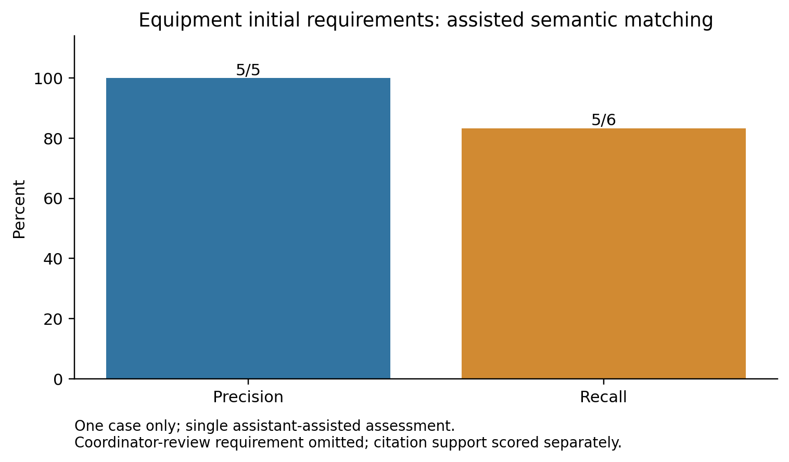
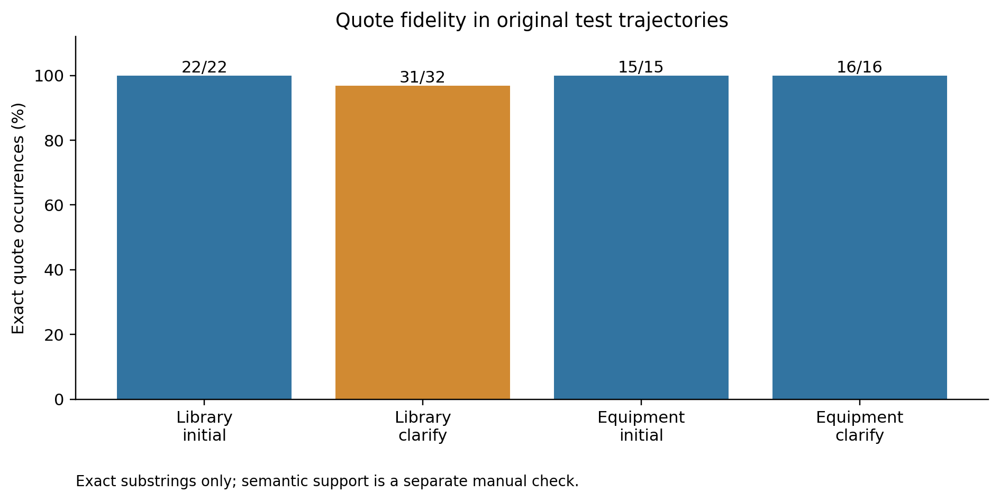
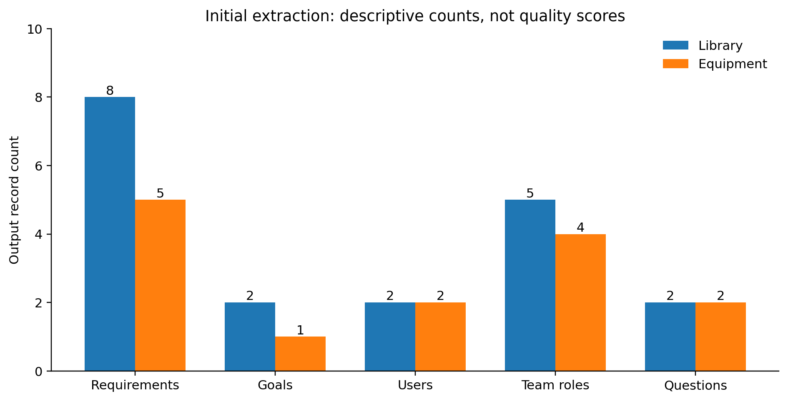
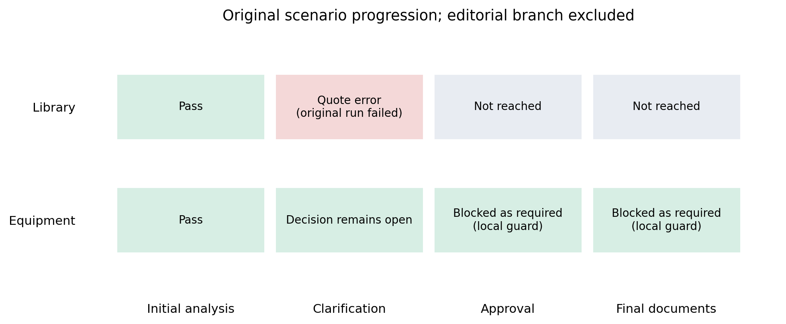
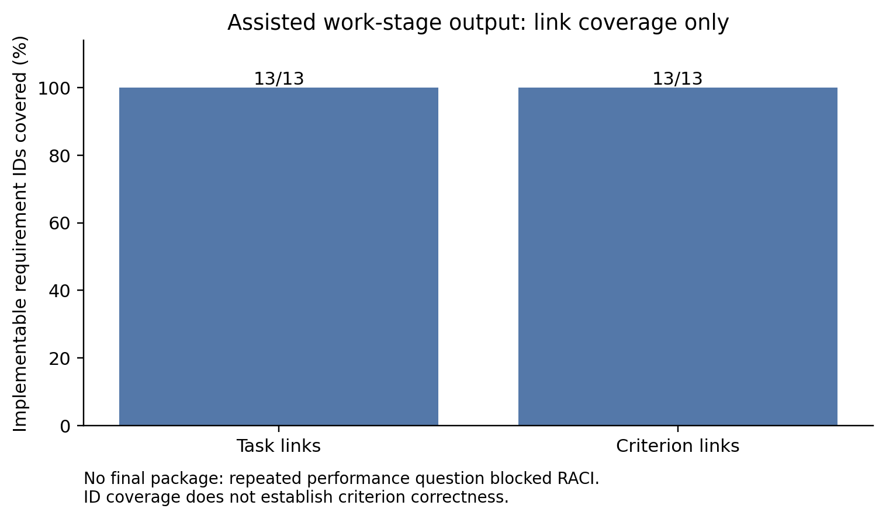
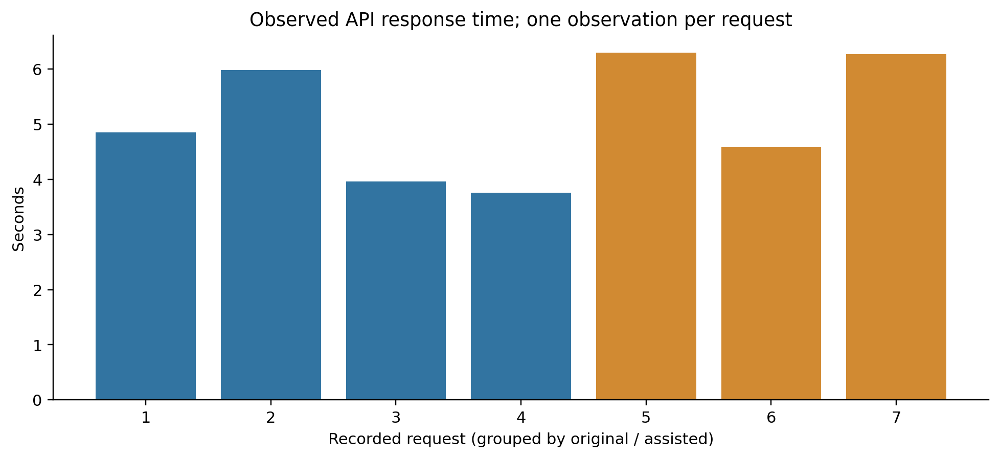

# Business Analysis Assistant — consolidated evaluation report

Version evaluated: v1.2-eval. Date: 21 November 2026. Model: gemini-3.1-flash-lite.

## 1. Executive assessment

The prototype extracts a useful structured analysis and correctly preserves an intentionally unresolved conflict. Its strongest measured properties are exact source quotation, reference integrity and safe refusal to finalize. It does not demonstrate reliable positive end-to-end completion on the final test set. The library trajectory fails during clarification; a separately owner-approved recovery then repeatedly stops on an unnecessary performance question.

Every implemented component is reviewed in this document. Where final-test execution did not reach a component, a preserved development output is assessed separately. These retrospective dev assessments close a component-inspection gap; they do not replace held-out evidence or turn an assisted output into an unassisted success. No new API call was made while compiling this report.

## 2. Evidence, datasets and scope

Three evidence groups are kept separate:

- Original final-test trajectories: two owner-approved synthetic test cases from two families, library and equipment. Four analysis calls are recorded after the library clarification extension. Gold labels and frozen application files were unchanged.
- Owner-assisted library component branch: two documented editorial changes (correct one quotation; restore available-copy borrowing), explicit owner approval, two work-generation calls and one intervening clarification. No final document package was produced.
- Retrospective development review: the saved PURE_002_without_team browser RACI-repair output. The analysis is a reference fixture, reply routing was reconstructed and test approval was simulated. The live RACI result and assembled documents are preserved, but this is not a fresh conversation from a new brief.

The final collection contains 7 live requests: 4 original and 3 assisted. Development examples and software tests are not added to that denominator. Original raw inputs, responses, rejected outputs and failures remain unchanged. Content judgments below use a single assistant-assisted assessment. No independent second-rating or inter-rater agreement study was performed.

## 3. Method and scoring conventions

Python checks JSON structure, nonempty exact quotes in the named source, ID/reference integrity, current approval, per-requirement coverage and RACI cardinality. Humans inspect whether the cited source supports the full claim, whether conditions are preserved and whether a question or assignment is justified.

Precision = correct extracted requirements / all extracted requirements. Recall = matched applicable gold units / all applicable gold units. Partial matches are reported separately. The equipment requirement metric uses six already-approved expected units and five output records. Library initial recall is not calculated because its approved initial labels do not define an exhaustive atomic requirement inventory. The library's after-clarification facts are not silently reused as initial gold.

Citation fidelity counts source occurrences, including repeated occurrences across revisions. It does not measure unique facts or semantic entailment. ID coverage is mechanical coverage, not acceptance-test completeness. Conflict matching checks the actual incompatible source pair. Missing final documents are N/A on the intentionally blocked trajectory; a failed positive trajectory remains a failure.

## 4. Original final-test results

| Indicator | Count | Rate | Qualification |
| --- | --- | --- | --- |
| Exact quote occurrences | 84/85 | 98.8% | Four original analysis snapshots; repeated quotations counted |
| Structurally accepted analysis outputs | 3/4 | 75.0% | Response-level metric, not scenario success |
| Equipment requirement precision | 5/5 | 100% | Assisted semantic annotation on one case |
| Equipment requirement recall | 5/6 | 83.3% | Coordinator-review requirement omitted as a separate record |
| Correct initial conflict-pair precision | 1/1 | 100% | Only one positive labeled conflict |
| Correct initial conflict-pair recall | 1/1 | 100% | No false conflict on the one clean initial case |
| Unchanged equipment requirements after reply | 5/5 | 100% | Existing output preserved; initial omission remains |

The equipment output has R1 browse, R2 submit one-item request, R3 view own requests, R4 remain pending until coordinator approval and R5 immediate approval without review. The explicit coordinator review action appears in U2 but not as a separate requirement. The contradictory R4/R5 pair is correctly retained rather than reconciled without authority.

Initial library: 22/22 exact occurrences. Initial equipment: 15/15. Equipment clarification: 16/16. Library clarification: 31/32. The invalid library quotation is R4, "Members sign in before... viewing their own current loans." The supplied sentence contains no ellipsis. The rejected output remains in the denominator.

## 5. Goals, product users, project roles and questions

The expected business goal appears in each initial result. Both expected product roles appear in each case: 4/4 case-role occurrences. Project-role presence is library 5/5 and equipment 4/4. The library representative is retained as a project adviser rather than automatically made a product user. These are assisted presence checks, not full precision/recall for all duties or evidence support.

| Item inspected | Observation | Assessment |
| --- | --- | --- |
| Library R1 | Add and update book-copy records share one requirement | Both actions retained; atomicity failure |
| Library R3/R4 sources | Short fragments omit the Member actor | Full brief supports facts; standalone citation context incomplete |
| Library Q1 | How to identify members and copies | Partly relevant to access/data identity; technical delegation required clarification |
| Library Q2 | Whether a project adviser needs application access | Low-value/uncertain relevance; not a product role by default |
| Expected library clarification | Borrowing eligibility or loan limits | Required loan-limit topic not asked |
| Equipment Q1 | Choose between incompatible approval policies | Relevant, neutral and correctly conflict-linked |
| Equipment Q2 | Preferred interfaces and viewing history | Lower-priority UI topic; history wording requires scope review |

No aggregate question precision, duty recall or semantic source-support percentage is invented from these observations. The owner considers the initial library analysis generally consistent with the brief; that practical acceptance coexists with these specific limitations.

## 6. Applying answers and complete-trajectory attempts

Equipment: the approved reply explicitly defers the approval-policy decision. A1 is recorded as still_open, C1 and both positions remain, and all five requirement records stay unchanged. Approval and generation guards both reject the resulting state, with zero additional API calls. This demonstrates the intended negative trajectory, not universal success on every applicable semantic check.

Library: after actual owner clarifications and the prepared business-rule response, the raw analysis fails exact-source validation. It also loses the standalone positive available-copy borrowing requirement. The original trajectory therefore does not reach approval or final documents.

The owner approved a separate recovery with two explicit changes: replace the R4 ellipsis with the original A1 sentence; restore available-copy borrowing as R15. The first work generation then asks about performance and blocks. The already-approved answer says that no quantitative target is agreed and the detail is nonblocking. Reanalysis passes, with requirements, goals, users, team and assumptions unchanged. The next work generation nevertheless asks the same blocking performance question again, attached to the English-language requirement R12. Further requests stop.

This exposes overblocking and a schema limitation: every work-plan open question blocks finalization, so an irrelevant/nonblocking question can prevent progress. The frozen system was not modified to force a passing test.

## 7. Specification component — separate development evidence

The specification is assembled by Python from approved analysis, rather than rewritten by the LLM. On the saved dev package, the complete specification equals the deterministic current-analysis projection. All 16 requirement records are preserved (16/16); all 9 expected sections are present (9/9). Export revalidates approval, source registry and package integrity.

This measures faithful copying of the supplied analysis, not the correctness or completeness of that analysis relative to the original brief. Proposed assumptions are in a separate section; the inspected real package has an empty assumptions array, so positive nonempty-assumption behavior is supported by software tests, not this observation. No final-test library specification was produced.

## 8. Tasks and acceptance criteria

On the second assisted library work output, five tasks and thirteen criteria mechanically cover all thirteen implementable requirement IDs. Both ID coverage rates are 13/13. The work remains intermediate because its performance question blocks finalization; no RACI is requested.

A separate retrospective dev package contains three tasks and thirteen criteria. All thirteen implementable IDs are task-covered and criterion-covered (13/13 each). All three tasks refer to existing requirements. Scope fidelity is weaker: 2/3 tasks stay within supplied capabilities; TASK1 says CRUD, which introduces deletion beyond explicit create/update.

| Task | Judgment | Evidence-based reason |
| --- | --- | --- |
| TASK1 | unsupported scope expansion | CRUD introduces deletion beyond supplied create/update operations. |
| TASK2 | faithful | The described work stays within the linked supplied scope. |
| TASK3 | faithful | The described work stays within the linked supplied scope. |

The following criterion review separates business wording from full citation support and full requirement-level test coverage. Nine of thirteen records have faithful business wording; two contain unsupported authentication preconditions and two are partial test definitions. This 9/13 (69.2%) is a retrospective assisted wording assessment, not final-test accuracy. AC5 is faithful to the full facts but its citation set is incomplete. AC8 is a valid positive scenario, while the negative quantity scenarios remain absent.

| Criterion | Requirement | Judgment | Reason |
| --- | --- | --- | --- |
| AC1 | R1 | unsupported precondition | Staff sign-in is not a confirmed product policy; S12 supports create permission, not authentication. |
| AC2 | R2 | unsupported precondition | Staff sign-in is not established by the account-creation source. |
| AC3 | R3 | faithful | Available-product browsing and a displayed list are supported. |
| AC4 | R4 | faithful | Customer, available product, add action and cart result are preserved. |
| AC5 | R5 | faithful | Signed-in customer, selected items and quantities match the full supplied facts; cited S14 alone omits the sign-in condition. |
| AC6 | R6 | faithful | Guest browsing without sign-in is supported. |
| AC7 | R7 | partial test definition | Does not explicitly assert that no order exists until successful sign-in; processing is less precise than placement. |
| AC8 | R9 | faithful | Positive integer update is observable and checks the requested value; negative quantity scenarios are still missing at requirement level. |
| AC9 | R10 | faithful | Removal produces an observable absence from the cart. |
| AC10 | R12 | faithful | Both allowed staff roles and product update are retained. |
| AC11 | R14 | faithful | Both allowed staff roles and account update are retained. |
| AC12 | R16 | faithful | Reference display follows successful creation; uniqueness is not invented. |
| AC13 | R17 | partial test definition | No-order rejection is correct, but a signed-in precondition is needed to isolate empty-cart failure from access failure. |

The assisted library output independently shows similar risks: AC13 omits the fewer-than-three-active-loans condition from successful borrowing; AC3/AC4 invent automatic sign-in redirection; AC1/AC9 add librarian sign-in as a precondition. These are content findings, even when every requirement ID is covered.

## 9. RACI — separate development evidence

The saved dev browser repair has six RACI rows. All six have exactly one Accountable and at least one Responsible, valid role IDs and supported task references (6/6 structural rows). Implementation now covers TASK1-TASK3 (3/3). Twelve of thirteen assignments have explicit source support under the conservative assisted review. The remaining QA Consulted assignment at UAT acceptance is not established by its cited testing-duty sentence; it may be reasonable, but must be proposed or confirmed rather than claimed as sourced.

Completeness is a separate issue. The approved dev labels contain eight role/activity semantic checks. Four pass, two partially cover implementation without deployment, and two lack test-execution activity. These are eight label checks, not eight distinct activities; some assess different assignments of the same expected activity.

| Gold check | Expected activity | Result | Actual row(s) |
| --- | --- | --- | --- |
| 1 | Approve business requirements | pass | RA1 |
| 2 | Prepare the specification | pass | RA2 |
| 3 | Implement and deploy the application | partial | RA6 |
| 4 | Prepare and execute tests | missing | None |
| 5 | Make the final release decision | pass | RA5 |
| 6 | Accept the specification | pass | RA3 |
| 7 | Execute tests | missing | None |
| 8 | Implement and deploy | partial | RA6 |

Thus assignment support is 12/13 (92.3%), while strict completion of these expected checks is only 4/8 (50.0%). The apparent contrast is meaningful: the assignments that exist are mostly supported, but entire duties are omitted. Neither metric is a held-out RACI score. Per-assignment source quotes and actual records are preserved in component_review.json.

## 10. Timing, software verification and uncertainty

The final/assisted collection's 7 requests total 35.698 seconds of measured response time; mean 5.100 seconds per request. Human review and local processing are excluded. This small descriptive sample is not a response-time guarantee or a cost measurement.

The v1.2 application has 86 Python tests; with collection-tool tests the suite has 89, plus four offline UI orchestration scenarios. These verify mechanics and guards with controlled responses. They do not increase the model-quality sample size. The historical actual-browser dev test used one RACI repair request and reached visible documents. It began with a reconstructed checkpoint and simulated approval; it is not a fresh final-test success.

Main validity limits: two test families, one conflict, one initial response per case, incomplete initial-library gold enumeration, assistant-authored annotations without inter-rater agreement, and a retrospective dev sample that has already influenced tuning. Rates from dev, final tests and assisted branches must not be pooled.

## 11. Conclusion and priorities

The prototype demonstrates useful extraction, traceable evidence and conservative unresolved-conflict handling. It has measurable weaknesses in citation context, atomicity, query relevance, acceptance-condition preservation, RACI duty completeness and positive workflow completion. An accepted initial analysis and high ID coverage do not establish a working complete positive trajectory.

Priority improvements for a later version: distinguish blocking and nonblocking work-stage questions; suppress questions already answered with an explicit scope decision; use source IDs in analysis as well as planning; enforce actor/condition preservation; test complete delivery RACI coverage. Such changes should be tuned on dev and evaluated on new held-out cases, rather than silently changing the current test result.

## 12. Artifact index and reproducibility

- Final raw evidence: tests/evaluation/pass-01/; separate recovery: tests/evaluation/pass-01-assisted-library/.
- Retrospective package: dev/evaluation/ui-raci-pass-01/after.session.json.
- Test metrics: test_metrics.json. Detailed retrospective annotations: component_review.json.
- Six figures: figures/ in PNG and SVG. Architecture: diagrams/ in PNG, SVG, PDF and Mermaid.
- Rebuild the package: python -m scripts.build_submission. Recompute final-test figures: python -m scripts.build_evaluation_figures.

No raw model response, test label or application file was changed to compile this report. The Word version contains editable headings, text and tables. The assisted annotations are exploratory and are not independently human-verified scores.
