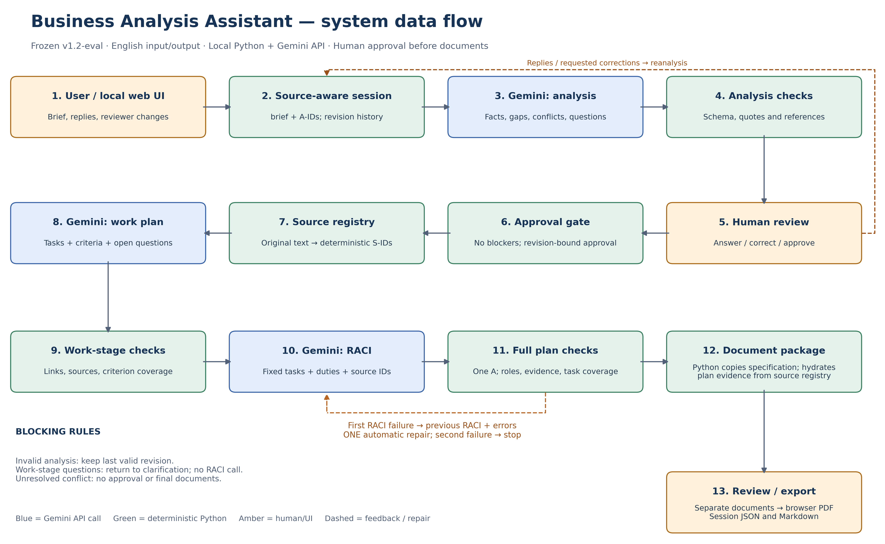
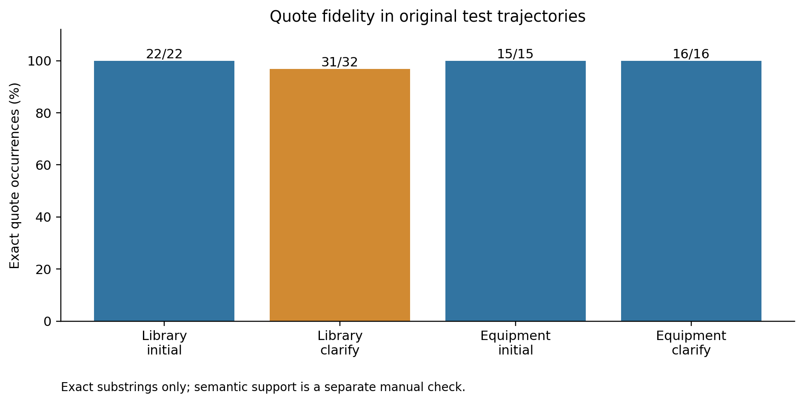

# Business Analysis Assistant — project report

Evaluation date: 21 November 2026. Publication preparation: 24 November 2026.

Application version: v1.2-eval. Model: gemini-3.1-flash-lite. All application briefs and outputs are English.

## 1. Task, users and selected scope

I built an NLP prototype that helps business analysts, Product Owners and small-project managers convert a small web-application brief into a structured requirements analysis and work plan. It extracts goals, product users, requirements, constraints and project roles; identifies gaps and contradictions; asks clarification questions; and uses reviewed requirements to prepare a specification, task breakdown, acceptance criteria and RACI.

The intended value is to reduce the manual effort of structuring a brief while retaining traceability and human control. The prototype does not treat model output as an agreed specification automatically. Facts must have supplied sources; assumptions remain separate; unresolved business decisions prevent finalization.

Selected scope includes English briefs, a Python CLI, a local single-user web interface, saved session revisions, explicit human review, Gemini API calls, structured JSON, source validation and individual browser-based PDF exports. Cloud deployment, integrations with project-management tools, authentication for the assistant itself, multi-user collaboration and automatic implementation of the generated tasks are outside scope. No RAG database or runtime multi-agent system is required for this selected information-extraction and generation task.

## 2. System architecture and component responsibilities



| Component | Input | Output / responsibility |
| --- | --- | --- |
| Local UI / CLI | Brief, actual replies, review actions | Explicit workflow actions; display evidence and validation errors |
| Session and source store | Original brief and replies | Source documents brief/A1/A2, question history, revision snapshots and approval hash |
| Analysis call | Current sources, previous analysis and actual question/reply history | Structured facts, gaps, conflicting requirement pairs, questions and resolutions |
| Analysis validator | Structured result and named sources | Schema/reference checks and exact nested quotations; rejection on errors |
| Review and approval gate | Current analysis and human actions | Clarifications or revision-bound approval; no finalization with blockers |
| Source registry | Original source text and approved evidence | Deterministic S-IDs, document names, exact fragments and offsets |
| Work-plan call and checks | Approved facts plus registry | Tasks and testable criteria with requirement/source IDs; open planning questions if needed |
| RACI call and checks | Fixed work, confirmed roles and registry | RACI with one A, at least one R, evidence and implementation-task coverage |
| Repair orchestration | First failed RACI and exact errors | At most one automatic RACI-only repair in the UI; first failure remains visible |
| Assembly and export | Validated current package | Deterministic specification, hydrated original quotes, editable session JSON, Markdown and print-ready individual documents |

Gemini is called for analysis/reanalysis, then for work planning and RACI separately. Python handles validation, identity/reference rules, session updates and exports. A typical initial-plus-one-clarification path to documents would use four model calls, or five if the single RACI repair is needed; additional real clarification turns can add calls. This is a description of control flow, not a measured completion guarantee.

The four document outputs are a specification, task breakdown, acceptance criteria and RACI. PDF export uses the browser's Print / Save as PDF destination and needs no model request. Text, headings and tables in this report are editable; the separate diagram SVG/Mermaid sources can be edited independently.

## 3. CRISP-DM applied to the project

### Business understanding

The business task was scoped to small web applications and reviewable analyst drafts. Success means preserving the brief's actors, actions, scope and conditions, asking necessary questions, applying actual replies, retaining source provenance and producing mutually consistent documents. Human agreement and source support are separate concepts. A supported fact can still await approval; an assumption is not implementation scope until confirmed.

### Data understanding

The development dataset contains four scenarios in two source families, adapted from supplied PURE-tagged briefs with synthetic stakeholder replies. All variants of a family stay in dev. Two separate synthetic domains — community library and equipment requests — were approved for final testing. Their expected behavior was fixed before generation. The repository records supplied PURE source-case IDs; the original external publication reference was not independently verified.

The data were examined for explicit requirements, process actors, team authority, conflicting statements and missing decisions. Team adviser participation was kept distinct from product access. Requirements evidence was traced to the brief or an actually supplied reply.

### Data preparation

Briefs are UTF-8 and must be nonempty within prototype limits. Each actual reply becomes a separately identified source. Expected labels and future answers remain outside model context. Approved test files and implementation snapshots are frozen with SHA-256 hashes. Initial input, raw outputs, failures and timing are retained. API keys come from .env/environment and are excluded from reports and experiment snapshots.

### Modeling

Gemini is accessed through a Python standard-library HTTP client with a JSON response schema. English prompts define the extraction categories, require exact evidence, distinguish facts from assumptions and forbid inventing policy. Goals, users, team roles, requirements, gaps, conflicts and questions have typed IDs and links.

Roles have one ID and multiple individually sourced responsibilities. Contradictions retain both requirements and refer to their IDs. Questions target a gap or conflict and indicate blocking status. After clarification, resolutions record whether a supplied answer resolved the question or left it open.

Planning uses a source-ID registry so the model selects evidence IDs and Python inserts original quotations. Tasks/criteria are generated before RACI. The second stage cannot rewrite validated work. One automatic RACI repair receives actual validation errors and the previous RACI; a second failure stops. The specification is copied from reviewed analysis rather than generated again.

### Evaluation

Software checks were combined with final-test observations and explicit content review. All components were inspected, but evidence strength differs. Final tests exercised analysis, clarification and blocking; downstream components were additionally reviewed from existing development outputs. Retrospective dev and owner-assisted results are reported separately rather than pooled with held-out outcomes.

Metrics include requirement precision/recall where approved countable gold units exist, exact quote occurrence rate, conflict-pair precision/recall, unchanged-requirement preservation, task/criterion ID coverage, scope fidelity, RACI structure, source-supported assignments and expected-duty completion. Missing/unexecuted stages are reported as such. Exact quotation, valid references and complete link coverage do not by themselves prove semantic correctness.

### Deployment / delivery

The application runs locally with python web_ui.py or the existing CLI. The UI supports brief analysis, batched replies, reviewer corrections, button-based requirements approval, generation, the single RACI repair and exports. Sessions stay in server memory unless downloaded; CLI sessions are saved explicitly. Page refresh preserves accepted server state but does not preserve unsent text. Cloud deployment is not part of this prototype. A demo video is still a submission deliverable, not an already recorded result.

## 4. Evaluation results

The owner-approved final dataset has two independent families. Seven live calls were recorded: four original-trajectory analysis calls and three calls in a separately owner-approved editorial recovery. No prompt or application tuning was performed from these final observations.

| Evidence group | Result | Important boundary |
| --- | --- | --- |
| Original quote fidelity | 84/85, 98.8% | Occurrences, not unique facts or semantic support |
| Original structural acceptance | 3/4, 75.0% | Responses, not full scenarios |
| Equipment requirement matching | Precision 5/5; recall 5/6 | Assisted per-record mapping on one case |
| Initial conflict matching | Precision 1/1; recall 1/1 | One positive and one clean initial case |
| Deferred-answer preservation | Existing equipment requirements 5/5 unchanged | Conflict correctly remains open |
| Assisted library work links | Tasks 13/13; criteria 13/13 | No final package: repeated performance question blocks |
| Retrospective dev specification | 16/16 requirements copied; 9/9 sections | Preserves supplied analysis; not an extraction-quality guarantee |
| Retrospective dev tasks | 2/3 scope-faithful | CRUD wording adds unrequested deletion |
| Retrospective dev criterion wording | 9/13 faithful; 2 partial; 2 unsupported preconditions | Citation support and missing negative scenarios assessed separately |
| Retrospective dev RACI | Structure 6/6; explicitly supported assignments 12/13; strict gold checks 4/8 | Entire test/deployment duties are missing despite mostly supported existing assignments |



The consolidated evaluation report contains the per-record task/criterion review, RACI expected-check mapping, source evidence and all six figures. These are single-assessor, assistant-assisted annotations without independent verification. The initial library analysis was qualitatively accepted as generally consistent with its brief; this assessment is separate from atomic metric scoring.

## 5. Scenario walkthrough and practical limitations

The equipment case contains two explicit incompatible rules: remain pending until coordinator approval, and immediately become approved without review. The system keeps both, asks a neutral question and receives an undecided reply. The resolution remains still_open. Approval and generation guards correctly reject finalization. The coordinator-review capability is nevertheless omitted as a separate requirement; correct blocking does not erase that extraction error.

The initial library analysis is usable and qualitatively accepted. During clarification, the model inserts an ellipsis into a supposed exact quotation and loses a standalone positive borrowing requirement. The validator rejects the result. In a separate owner-approved component branch, those two records are corrected, but the planner repeatedly raises a performance question that was already explicitly described as nonblocking. The positive final-test journey therefore does not reach final documents.

A historical simple office-hours demo and a saved dev RACI-repair browser test show document assembly and display working under controlled inputs. The latter uses a reconstructed checkpoint and simulated test approval. These must be presented as such in the video; they are not proof of a fresh successful final-test conversation.

Main limitations are small sample size, model nondeterminism, uneven question relevance, merged actions, incomplete citation context, acceptance criteria that omit preconditions or invent implementation behavior, and missing RACI duties. The current work-question schema treats every planning question as blocking, which amplifies irrelevant questions into workflow failure. High local scores do not imply successful full completion.

Future development should prioritize blocking/nonblocking planning decisions, suppression of already-answered questions, source IDs for analysis, semantic preservation of actors and conditions, and complete delivery responsibility. New changes should be tuned on dev and evaluated on new held-out material.

## 6. Managing the AI coding assistant

I used the coding assistant to implement and inspect the prototype, write local regressions, preserve experiment artifacts and prepare reproducible evaluation tooling. Its context included the intended users and scope, current schemas, source rules, approved dev expectations and actual validator failures. Final-test expected labels remained outside application requests and were not used to tune the frozen implementation.

AGENTS.md records the project constraints and CRISP-DM guidance: do not invent decisions, preserve source links, distinguish product and project roles, keep assumptions separate, validate output and report offline checks separately from live calls. The prepare-eval-case skill standardizes source/expectation preparation and owner approval. The run-analysis-eval skill standardizes artifact capture, reference/evidence checks and error diagnosis.

The owner reviewed briefs, labels and requirements and supplied additional business decisions where needed. The assistant proposed and implemented changes; local tests checked mechanics. A concrete lesson is that stronger structural safeguards can reveal additional model failures and can overblock a valid small project. I therefore kept semantic review distinct from Python validation and retained unsuccessful attempts rather than reporting only successful demonstrations.

## 7. Reproducibility and running the application

From the project directory, configure GEMINI_API_KEY privately in .env. The default model is gemini-3.1-flash-lite. The runtime uses the Python standard library; plotting/report tooling additionally uses matplotlib, numpy and Pillow.

```powershell
python web_ui.py
```

Open http://127.0.0.1:8000. Analyze a brief, inspect evidence, submit actual answers, request corrections if needed, then approve and generate. A first RACI failure is shown and automatically repaired once. Inspect the content before using it. PDF buttons open a printable individual document; choose Save as PDF in the browser dialog. Download session JSON before stopping the server.

```powershell
python -m unittest -q test_business_analysis test_workflow test_component_eval test_plan_coverage test_reviewed_baseline test_plan_sources test_web_ui test_staged_plan test_document_export test_evaluation_collection
node test_generation_ui.cjs
python build_evaluation_figures.py
python build_submission.py
```

The recorded software suite has 89 passing Python tests including collection-tool tests, plus four offline UI flow scenarios. These are not 89 model-quality test cases. Frozen code, raw request/response logs, exact source text, execution outcomes and hashes make the reported observations auditable.

## 8. Suggested video outline — maximum 10 minutes

| Time | What to show |
| --- | --- |
| 0:00–1:00 | Problem, intended users and selected scope |
| 1:00–2:30 | Architecture diagram; identify Python versus model calls |
| 2:30–5:30 | Running local UI, evidence and clarification; explicitly label any saved checkpoint or synthetic demonstration |
| 5:30–6:30 | One document package and separate PDF export; explain approval and validation |
| 6:30–8:30 | Evaluation plots, one actual error and the correctly blocked conflict; distinguish dev/test/assisted results |
| 8:30–9:30 | AGENTS.md, custom skills, context management and key lessons |
| 9:30–10:00 | Limitations and next improvements |

Demonstrations distinguish newly generated output from saved checkpoints. The library final-test trajectory did not complete successfully.

## 9. Conclusion

This project meets the intended NLP assistant architecture: structured extraction, follow-up questions, source-aware state and a reviewed document-generation workflow. The evaluation demonstrates useful initial analysis and safe unresolved-conflict handling, while exposing weak positive completion and incomplete downstream semantics. The prototype and evidence are suitable for a critical assignment report, provided those limitations and the scope of successful demonstrations are stated clearly.

## References and project artifacts

- GenAI. Assignment 1. Build an NLP System.pdf, supplied assignment, pages 1–4.
- AGENTS.md; .agents/skills/prepare-eval-case/SKILL.md; .agents/skills/run-analysis-eval/SKILL.md.
- tests/ba_test_cases.json, final version 1.0; dev/cases/ba_dev_cases.json, version 0.4.
- tests/evaluation/pass-01/ and tests/evaluation/pass-01-assisted-library/.
- dev/evaluation/ui-raci-pass-01/; dev/evaluation/final-system/v1.2-eval/.
- Evaluation_Report.docx; component_review.json; test_metrics.json; separate architecture and plotting assets.
